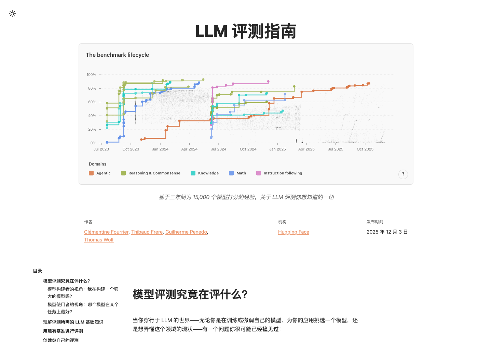

# LLM 评测指南（中文翻译版）

> **The LLM Evaluation Guidebook** 的简体中文翻译版
>
> 基于三年间为 15,000 个模型打分的经验，关于 LLM 评测你想知道的一切。



- 原文：[Hugging Face Spaces · OpenEvals/evaluation-guidebook](https://huggingface.co/spaces/OpenEvals/evaluation-guidebook)
- 在线阅读：[leonyuhe.github.io/evaluation-guidebook_zh](https://leonyuhe.github.io/evaluation-guidebook_zh/)
- 作者：Clémentine Fourrier、Thibaud Frere、Guilherme Penedo、Thomas Wolf（Hugging Face）
- 中文翻译维护：[leonyuhe](https://github.com/leonyuhe)

## 关于这本指南

这是一份写给模型构建者、模型使用者和评测工作者的实践指南：

- **为什么评测**：模型构建者如何验证消融实验，模型使用者如何挑选模型。
- **评测基础**：分词、推理、对数似然评测与生成式评测。
- **现有基准**：2025 年值得关注的评测、如何阅读基准数据、为什么复现公布分数如此困难。
- **训练期基准选择**：如何为预训练和中训练挑选高信号、低成本的评测。
- **自建评测**：从零设计一个可靠、可解释、可复现的评测。
- **人工评测**：标注者选择、标注指南、一致性分析与成本控制。

## 翻译说明

- 正文、章节标题、表格、图注和界面文案已翻译为简体中文。
- 代码、命令行参数、变量名、URL、模型名、论文名、数字与公式保持原文。
- 交互式图表由原站脚本渲染，**图内标签**与**脚注引用卡片**保留英文原文；正文对每张图的解释均已翻译。
- 本译文为社区翻译，**非 Hugging Face 官方中文版**。如发现术语或表述问题，欢迎提交 Issue / PR。

## 本地运行

需要 Node.js 20+。

```bash
cd app
npm install
npm run dev          # http://localhost:4321/evaluation-guidebook_zh/
```

构建静态站点：

```bash
cd app
npm run build        # 输出到 app/dist
```

## 部署到 GitHub Pages

在线站点：<https://leonyuhe.github.io/evaluation-guidebook_zh/>

仓库中的 `docs/` 是构建好的静态站点，`gh-pages` 分支与它保持同步，GitHub Pages 从该分支发布。

重新构建并发布：

```bash
cd app
npm run build:gh
cd ..
git add docs
git commit -m "rebuild site"
git subtree push --prefix docs origin gh-pages
```

`build:gh` 会执行 Astro 构建、把根路径资源改写成 `/evaluation-guidebook_zh/` 前缀，并把产物复制到 `docs/`。

## 目录结构

```text
.
├── app/                 # Astro 源码
│   ├── src/content/     # 中文 article.mdx、章节 MDX、图片与交互图表
│   └── public/          # 静态资源
├── docs/                # 构建产物，GitHub Pages 站点
├── tools/               # 分块、校验、回填与路径修正脚本
├── LICENSE              # CC BY 4.0
└── NOTICE               # 原文署名与翻译说明
```

## 许可与署名

原文及图表由 Hugging Face 与原作者以 [CC BY 4.0](https://creativecommons.org/licenses/by/4.0/) 发布。本译文沿用同一许可，转载请注明原文与译者，并链接到本仓库。

详见 [LICENSE](LICENSE) 与 [NOTICE](NOTICE)。

## 致谢

感谢 Clémentine Fourrier、Thibaud Frere、Guilherme Penedo、Thomas Wolf 写下这份指南并开放全部图表；感谢 Hugging Face 与 OpenEvals 团队提供原文与交互式图表。
